# E-DBA · Education Data Bay Area

E-DBA is Group C03's software engineering course project. Built with Flask, it is a role-based platform for sharing educational data across organizations. Organization administrators manage members and services, data providers publish courses and configure external APIs, and data consumers access services according to their permission level.

> This is a course demonstration project. Some features require external thesis, student information, and banking services. The application has not been reviewed for production security.

## Features

- **Email verification and organization registration:** Users sign in with an email verification code. An organization convener submits a registration request with a PDF proof document.
- **Two-stage registration review:** E-Admin performs the initial review and Senior E-Admin makes the final decision. Final approval creates the organization and its O-Convener account.
- **Organization and member management:** Set DataUser access levels, service availability, the organization's bank account, and membership fees.
- **Educational data sharing:** Publish course information and configure external APIs for thesis services, student identity verification, and GPA queries.
- **Policies and logs:** Platform administrators manage policies and inspect logs across organizations; conveners can inspect their own organization's logs.

## Roles and permissions

| Role | Main functions |
| --- | --- |
| **T-Admin** | Add and remove E-Admin and Senior E-Admin accounts; view and answer user support requests. |
| **E-Admin** | Review organization registrations; upload and manage platform policies; set the platform bank account and membership fees; filter logs across organizations. |
| **Senior E-Admin** | Make the final decision on registrations approved by E-Admin; create an organization and O-Convener after approval. |
| **O-Convener** | Manage members and access levels, including bulk import from Excel; enable services and set their visibility; maintain the organization bank account, pay membership fees, and view organization logs. |
| **DataUser Level 1** | Browse policies, submit support requests, view courses, search theses, and download thesis PDFs. |
| **DataUser Level 2** | Use Level 1 features plus student identity verification and GPA queries, including batch queries from Excel files. |
| **DataUser Level 3 / Data Provider** | Use Level 1 and 2 features, maintain course information, and configure external service APIs. |

### Sign-in and registration

Sign-in and registration use email verification codes. An O-Convener provides organization details and a PDF proof document when registering.

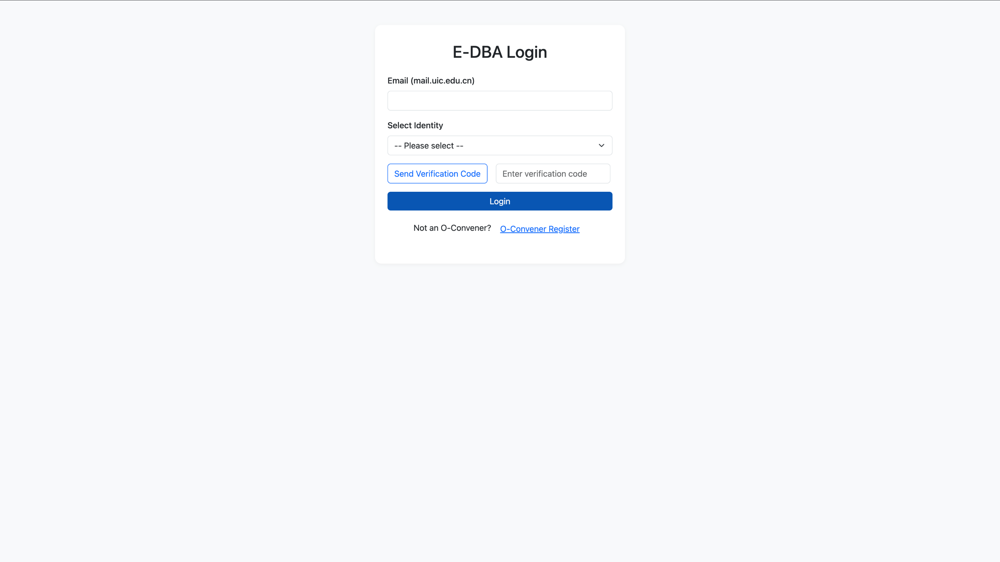

### Platform administrators

T-Admin manages administrator accounts and support requests. E-Admin reviews registrations, sets fees and the platform account, manages policies, and checks logs. Senior E-Admin performs the final registration review.

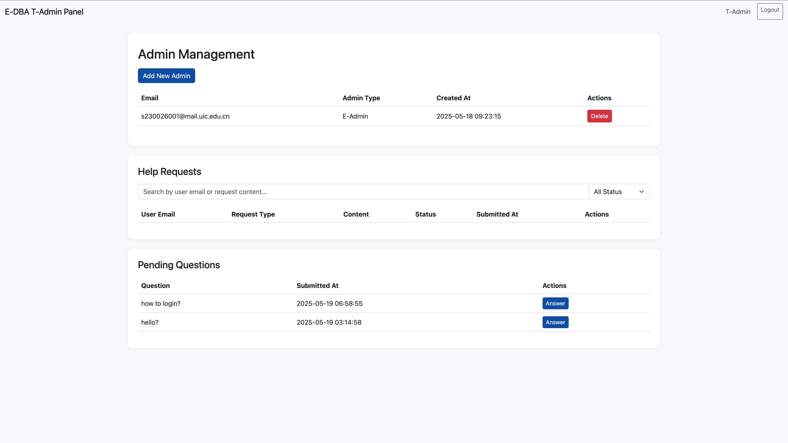
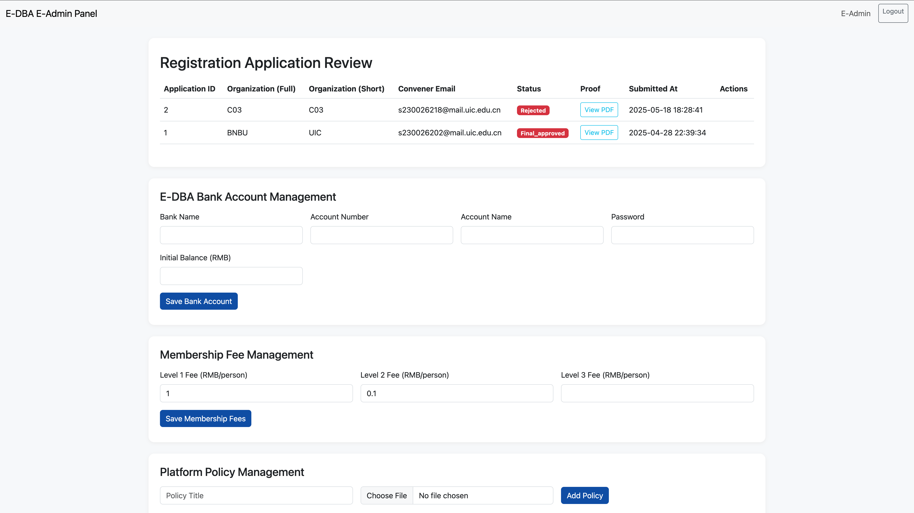
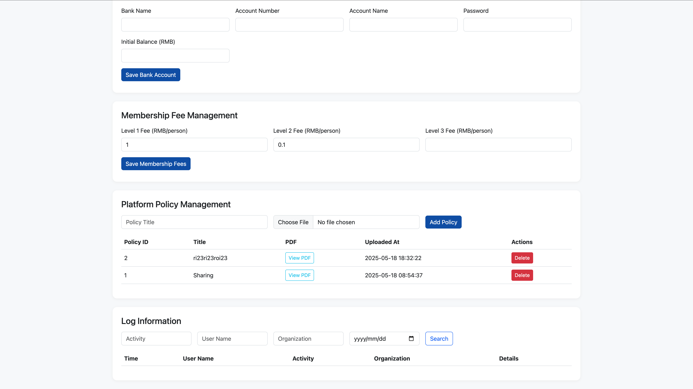
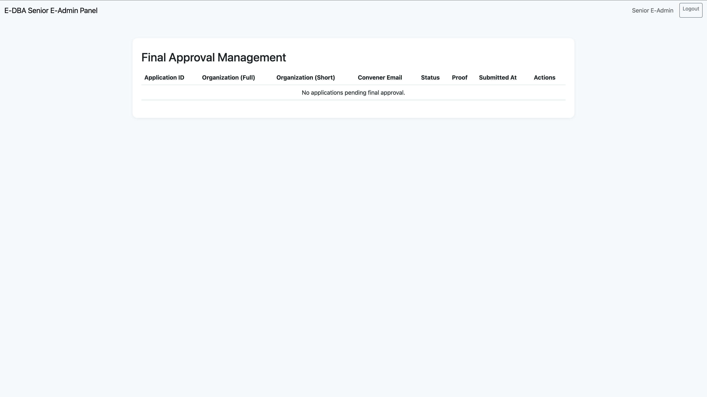

### Organization convener

The O-Convener workspace provides member and service management, access level settings, a membership fee summary, and organization logs.

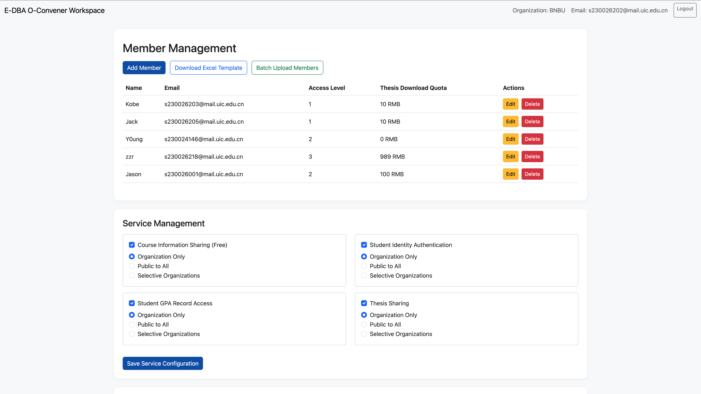
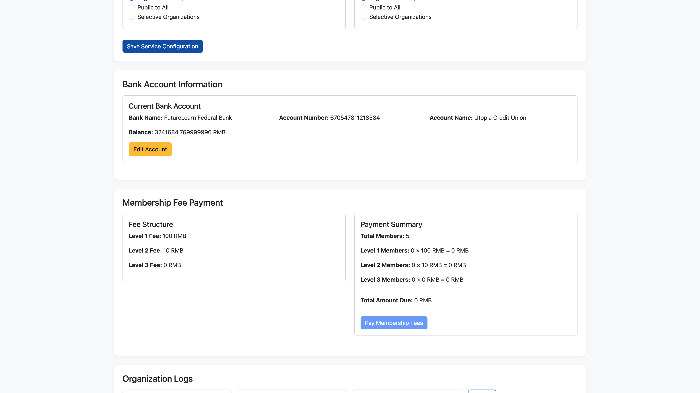

### Data providers and consumers

A Level 3 Data Provider maintains courses and configures service APIs. A Level 1 DataUser accesses public course and thesis services; Level 2 adds student identity verification and GPA queries.

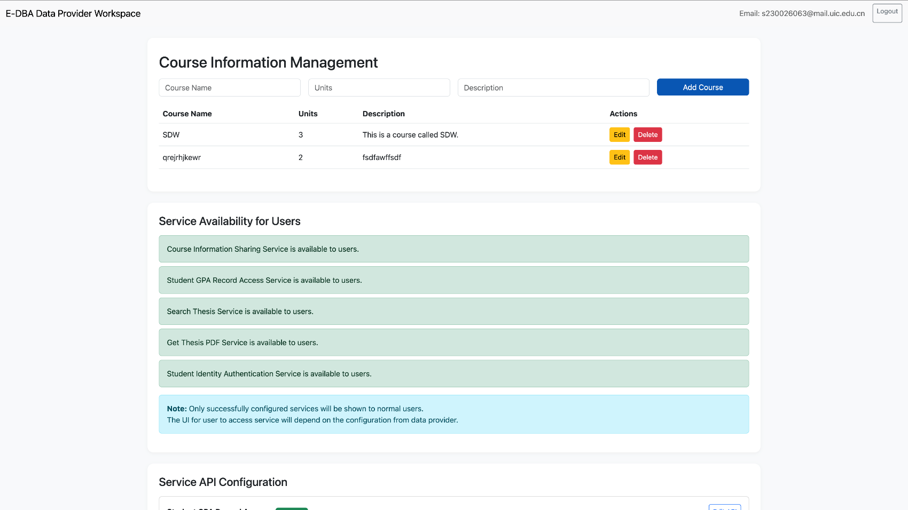
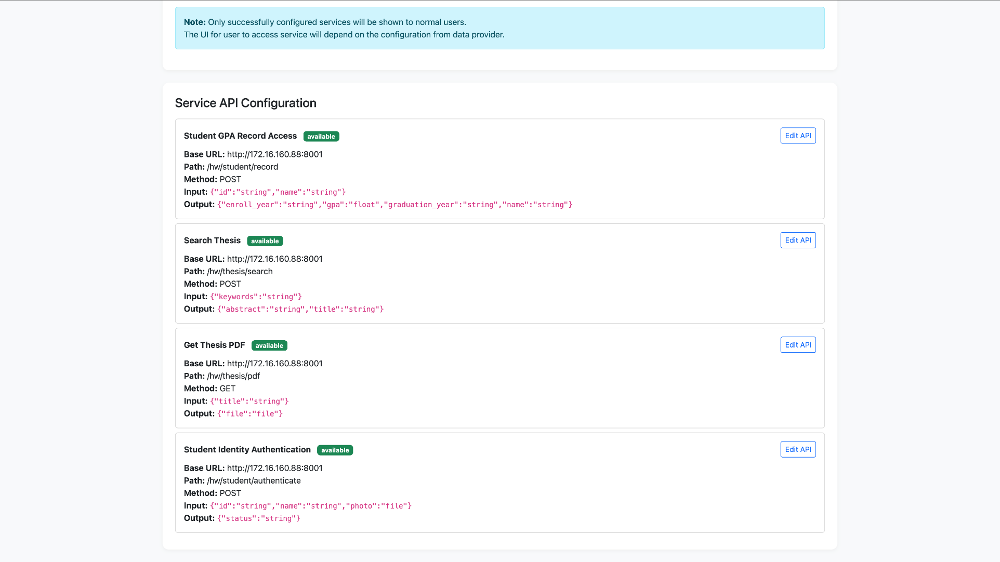
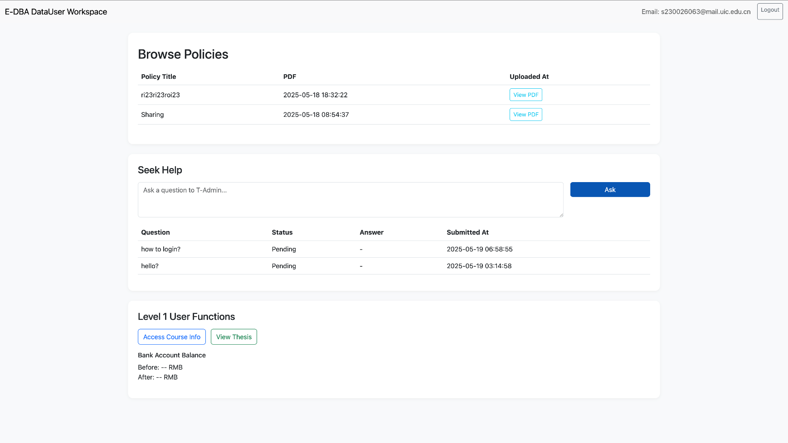
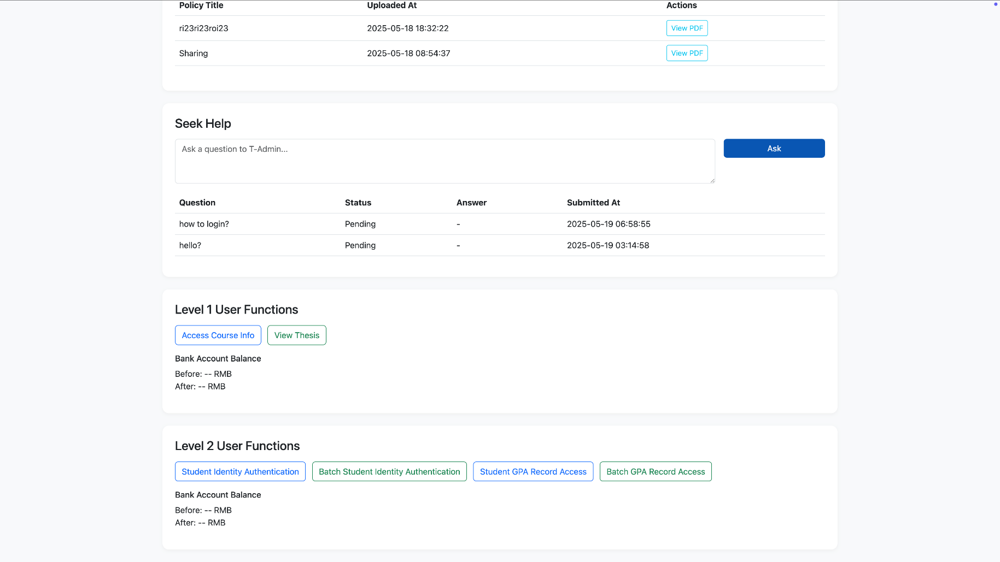

These interface screenshots were extracted from slides 19–33 of the course presentation.

## Technology and structure

- Python, Flask, Flask-SQLAlchemy, PyMySQL, and MySQL
- HTML, Bootstrap, and vanilla JavaScript; pandas and openpyxl support some batch operations
- Flask Blueprints organize routes by feature

```text
app/
├── models/       # Users, organizations, registrations, services, courses, fees, and logs
├── views/        # Role-specific pages and business endpoints
├── templates/    # Workspace pages
└── config/       # Database configuration
teamwork.py       # Flask entry point
```

## Run locally

Use Python 3.10+ and MySQL. These commands assume a macOS or Linux shell:

```bash
python3 -m venv .venv
source .venv/bin/activate
pip install -r requirements.txt
cp .env.example .env
```

Edit `.env` and provide your own `DATABASE_URL`, `FLASK_SECRET_KEY`, `SMTP_EMAIL`, `SMTP_PASSWORD`, and `SENIOR_ADMIN_EMAIL`. Use an SMTP authorization code for `SMTP_PASSWORD`. Git ignores `.env`.

Create the database in MySQL:

```sql
CREATE DATABASE IF NOT EXISTS `E-DBA`
DEFAULT CHARACTER SET utf8mb4
DEFAULT COLLATE utf8mb4_unicode_ci;
```

Load the environment variables and start the app:

```bash
set -a
source .env
set +a
python teamwork.py
```

Open <http://127.0.0.1:5000/user/login>. The first start creates database tables, but it does not create the initial T-Admin account. See the [detailed usage guide (Chinese)](项目使用文档.md) for initialization and workflow instructions.

## Demo scope and known limitations

- Thesis search and download, student identity verification, and GPA queries require working external APIs.
- Membership fee payments call an external bank transfer service from the course environment and may fail outside it.
- Verification codes are stored only in process memory and disappear when the server restarts.
- The DataUser organization list currently shows only the user's own organization; cross-organization search is incomplete.
- Support questions and replies share one database field, so a reply overwrites the original question text. Logging does not yet cover every operation.

This project is intended for coursework demonstrations, not direct deployment on a public server. The [detailed usage guide (Chinese)](项目使用文档.md) describes the environment, data models, and endpoints.
